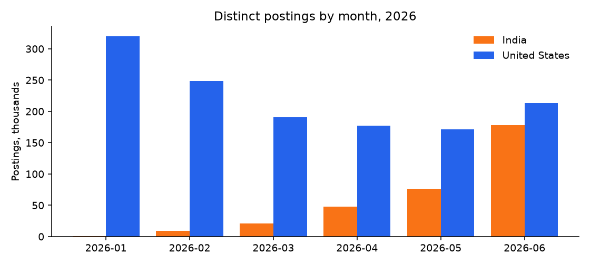
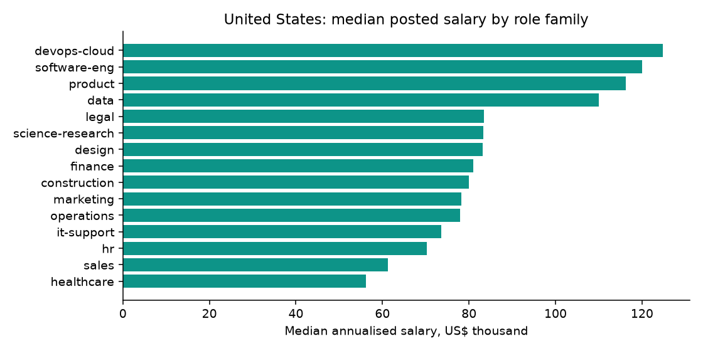
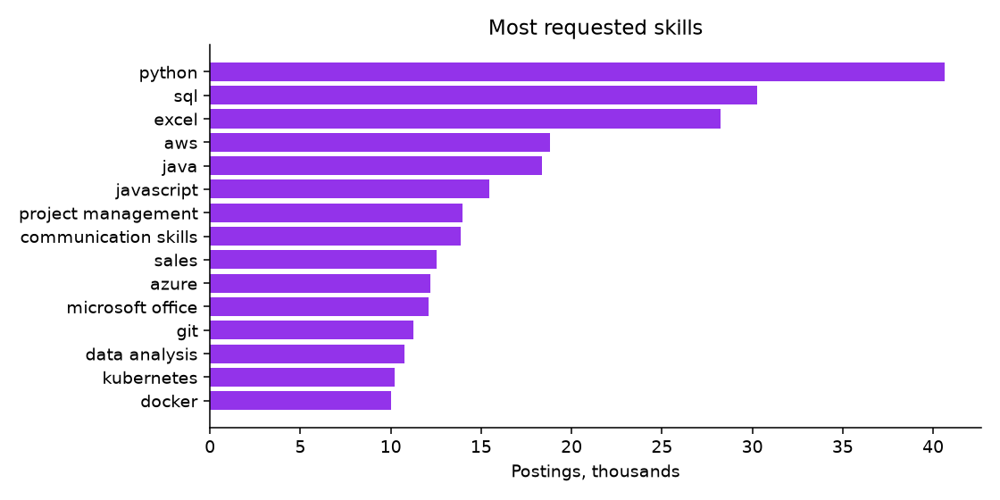

# Job Postings 2026: India and United States: findings, method and data card

*Fliar Research · released October 2026 · licence CC BY-NC 4.0*

**How this dataset was acquired.** Every row comes from the [Radar API](https://github.com/fliarbi/radar-api-mcp), Fliar's company-data API and MCP server. Radar
collects public job postings across job boards and company career pages every day, parses each one into structured fields (title,
employer, location, work mode, experience, education, skills and pay) and normalises salaries to an annual US-dollar figure. This
release covers postings published in India and the United States between January and June 2026, deduplicated so that a job
re-posted on several sites appears once. It contains no description text, no application links and no recruiter names. The full,
daily-updated postings, with filters for skills, salary, experience and freshness, are available through `POST /v1/jobs/search`
([reference](https://github.com/fliarbi/radar-api-mcp/blob/main/docs/reference/search_jobs.md)) or the `search_jobs` MCP tool.

> **This file is a 6% sample: 100,009 of 1,654,294 job postings.** It keeps every record for a fixed subset of companies.
> The subset is chosen by a hash, so it stays the same from one release to the next. The findings and tables below were computed
> on the **full** data. For the rest, the withheld fields and monthly updates, [get a Radar API key](https://fliarbi.com/radar-api/developer) ([docs](https://github.com/fliarbi/radar-api-mcp)).
> Each row's `fliar_profile_url` opens the company's full profile on Fliar.

## Key findings

1. **1,654,294 distinct job postings from 240,895 employers, January to June 2026**: 1,320,685 in the United States and 333,609 in India.
2. **14% of postings state a salary.** Median annualised pay: US $60.0K, India $8.7K; 91% of salaried postings are in the US.
3. **Few postings advertise remote work.** Postings marked remote (in the work-mode field or the title): 1.1% in India, 1.6% in United States; hybrid: 0.2% in India, 0.4% in United States.
4. **The most requested skills** across 458,559 postings that list skills: python (40,630), sql (30,259), excel (28,234), aws (18,795), java (18,370).
5. **Healthcare is the largest role family (20% of postings with a role)**, followed by sales (10%) and finance (7%).
6. **Tech pay gap:** the median salaried software, data or cloud posting offers $116.5K in the US and $18.3K in India, 6× apart at market exchange rates.

### Postings by month and country

Full data after deduplication. India counts rise sharply through the half-year, which reflects growing collection as well as hiring.

| Month   | India postings   | India employers   | India with salary   | United States postings   | United States employers   | United States with salary   |
|:--------|:-----------------|:------------------|:--------------------|:-------------------------|:--------------------------|:----------------------------|
| 2026-01 | 878              | 346               | 76.9%               | 319,660                  | 91,226                    | 1.9%                        |
| 2026-02 | 9,508            | 3,334             | 9.3%                | 248,330                  | 79,167                    | 3.9%                        |
| 2026-03 | 20,683           | 6,865             | 6.0%                | 190,529                  | 58,596                    | 8.0%                        |
| 2026-04 | 48,074           | 16,714            | 3.4%                | 177,369                  | 51,540                    | 23.1%                       |
| 2026-05 | 76,507           | 21,073            | 9.7%                | 171,570                  | 48,877                    | 36.8%                       |
| 2026-06 | 177,959          | 44,166            | 5.0%                | 213,227                  | 52,205                    | 34.2%                       |

### Most posted job titles (top 50)

Titles lower-cased, with location suffixes and "Hiring:" prefixes removed. Remote share is the share of postings marked remote.

| #   | Job title                       | Postings   | Employers   | US share   | Median salary (US$)   | Remote share   | Role family        |
|:----|:--------------------------------|:-----------|:------------|:-----------|:----------------------|:---------------|:-------------------|
| 1   | Travel Nurse                    | 12,231     | 64          | 100.0%     | $105.4K               | 0.0%           | healthcare         |
| 2   | Project Manager                 | 7,234      | 4,459       | 87.3%      | $100.0K               | 0.9%           | product            |
| 3   | Registered Nurse                | 5,890      | 2,631       | 99.8%      | $79.5K                | 0.2%           | healthcare         |
| 4   | Manager                         | 5,370      | 2,780       | 32.9%      | $42.0K                | 0.2%           | finance            |
| 5   | Medical Assistant               | 4,961      | 2,275       | 99.9%      | $41.6K                | 0.1%           | healthcare         |
| 6   | Assistant Manager               | 3,913      | 2,021       | 59.5%      | $38.9K                | 0.0%           | retail-hospitality |
| 7   | Administrative Assistant        | 3,717      | 2,895       | 98.4%      | $41.6K                | 0.6%           | admin              |
| 8   | General Manager                 | 3,447      | 2,265       | 87.1%      | $70.0K                | 0.1%           | operations         |
| 9   | Account Manager                 | 3,440      | 2,573       | 90.3%      | $55.0K                | 1.1%           | sales              |
| 10  | Maintenance Technician          | 3,191      | 2,229       | 99.3%      | $47.8K                | 0.0%           | manufacturing      |
| 11  | Rn                              | 3,146      | 1,481       | 100.0%     | $90.0K                | 0.0%           | healthcare         |
| 12  | Customer Service Representative | 3,035      | 2,330       | 95.1%      | $40.0K                | 2.6%           | customer-service   |
| 13  | Account Executive               | 2,928      | 1,979       | 88.3%      | $70.2K                | 2.2%           | sales              |
| 14  | Senior Software Engineer        | 2,754      | 1,785       | 52.0%      | $96.2K                | 2.3%           | software-eng       |
| 15  | Sales Manager                   | 2,626      | 1,807       | 62.6%      | $64.3K                | 0.9%           | sales              |
| 16  | Sales Associate                 | 2,613      | 1,250       | 93.6%      | $33.3K                | 0.7%           | sales              |
| 17  | Business Analyst                | 2,433      | 1,614       | 65.6%      | $70.7K                | 1.6%           | other              |
| 18  | Physician                       | 2,400      | 572         | 99.9%      | $41.6K                | 0.2%           | healthcare         |
| 19  | Head                            | 2,323      | 958         | 0.0%       | $54.0K                | 0.0%           | finance            |
| 20  | Software Engineer               | 2,306      | 1,475       | 51.1%      | $94.8K                | 1.7%           | software-eng       |
| 21  | Receptionist                    | 2,298      | 1,922       | 97.8%      | $39.5K                | 0.0%           | customer-service   |
| 22  | Operations Manager              | 2,238      | 1,703       | 89.5%      | $72.0K                | 0.4%           | operations         |
| 23  | Sales Representative            | 2,140      | 1,419       | 96.2%      | $60.0K                | 2.8%           | sales              |
| 24  | Nurse Practitioner              | 2,110      | 1,128       | 100.0%     | $120.0K               | 0.9%           | healthcare         |
| 25  | Server                          | 2,094      | 1,577       | 100.0%     | $35.2K                | 0.0%           | retail-hospitality |
| 26  | Business Development Manager    | 2,087      | 1,625       | 60.5%      | $70.0K                | 1.7%           | sales              |
| 27  | Travel Nurse Rn                 | 2,033      | 232         | 100.0%     | $114.0K               | 0.0%           | healthcare         |
| 28  | Physical Therapist              | 2,015      | 1,195       | 99.8%      | $90.0K                | 0.1%           | healthcare         |
| 29  | Caregiver                       | 1,975      | 1,047       | 99.7%      | $36.3K                | 0.0%           | healthcare         |
| 30  | Certified Nursing Assistant     | 1,970      | 1,279       | 99.9%      | $40.0K                | 0.0%           | healthcare         |
| 31  | Security Officer                | 1,954      | 862         | 99.7%      | $39.4K                | 0.0%           | security           |
| 32  | Warehouse Associate             | 1,933      | 1,275       | 99.8%      | $37.4K                | 0.0%           | logistics          |
| 33  | Senior Manager                  | 1,930      | 1,055       | 14.9%      | $45.0K                | 0.4%           | finance            |
| 34  | Occupational Therapist          | 1,926      | 1,264       | 98.5%      | $95.4K                | 0.1%           | healthcare         |
| 35  | Product Manager                 | 1,847      | 1,413       | 51.9%      | $100.0K               | 1.1%           | product            |
| 36  | Dental Assistant                | 1,822      | 1,159       | 100.0%     | $41.6K                | 0.1%           | healthcare         |
| 37  | Senior Project Manager          | 1,724      | 1,126       | 89.2%      | $135.0K               | 1.1%           | product            |
| 38  | Director                        | 1,638      | 1,071       | 50.9%      | $120.0K               | 0.9%           | finance            |
| 39  | Senior Accountant               | 1,628      | 1,360       | 86.9%      | $82.5K                | 0.9%           | finance            |
| 40  | Executive Assistant             | 1,617      | 1,373       | 86.0%      | $58.2K                | 0.7%           | admin              |
| 41  | Licensed Practical Nurse        | 1,613      | 1,149       | 100.0%     | $62.4K                | 0.1%           | healthcare         |
| 42  | Graphic Designer                | 1,604      | 1,391       | 56.4%      | $37.4K                | 2.1%           | design             |
| 43  | Program Manager                 | 1,569      | 1,200       | 80.1%      | $95.0K                | 0.7%           | product            |
| 44  | Cna                             | 1,536      | 857         | 99.9%      | $41.6K                | 0.0%           | healthcare         |
| 45  | Delivery Driver                 | 1,503      | 845         | 99.9%      | $41.6K                | 0.1%           | logistics          |
| 46  | Project Engineer                | 1,449      | 1,023       | 91.3%      | $83.2K                | 0.1%           | construction       |
| 47  | Recruiter                       | 1,397      | 1,061       | 90.6%      | $60.0K                | 1.4%           | hr                 |
| 48  | Social Worker                   | 1,361      | 861         | 99.7%      | $65.0K                | 0.1%           | healthcare         |
| 49  | Data Engineer                   | 1,350      | 994         | 39.7%      | $29.7K                | 1.4%           | data               |
| 50  | Financial Analyst               | 1,320      | 1,091       | 85.3%      | $75.0K                | 0.9%           | finance            |

### Most requested skills with median salary (top 50)

Skills as listed in postings (lower-cased). Salary medians over postings that state a salary.

| #   | Skill                  | Postings   | Employers   | India share   | Postings with salary   | Median salary, US (US$)   | Median salary, India (US$)   |
|:----|:-----------------------|:-----------|:------------|:--------------|:-----------------------|:--------------------------|:-----------------------------|
| 1   | python                 | 40,630     | 11,367      | 93.8%         | 2,515                  | $120.0K                   | $21.0K                       |
| 2   | sql                    | 30,259     | 9,618       | 91.2%         | 2,025                  | $106.0K                   | $18.0K                       |
| 3   | excel                  | 28,234     | 13,259      | 45.1%         | 5,573                  | $75.0K                    | $3.6K                        |
| 4   | aws                    | 18,795     | 6,827       | 92.7%         | 876                    | $127.4K                   | $27.0K                       |
| 5   | java                   | 18,370     | 5,934       | 95.3%         | 1,161                  | $124.8K                   | $19.2K                       |
| 6   | javascript             | 15,440     | 7,137       | 97.0%         | 835                    | $110.0K                   | $14.2K                       |
| 7   | project management     | 13,961     | 7,240       | 82.0%         | 1,186                  | $104.2K                   | $9.9K                        |
| 8   | communication skills   | 13,872     | 8,637       | 100.0%        | 704                    |                           | $3.9K                        |
| 9   | sales                  | 12,533     | 6,778       | 97.8%         | 1,914                  | $52.0K                    | $6.6K                        |
| 10  | azure                  | 12,212     | 5,029       | 94.3%         | 534                    | $125.0K                   | $24.0K                       |
| 11  | microsoft office       | 12,070     | 6,910       | 30.1%         | 3,173                  | $61.4K                    | $3.0K                        |
| 12  | git                    | 11,235     | 5,121       | 96.9%         | 397                    | $121.5K                   | $8.2K                        |
| 13  | data analysis          | 10,743     | 5,771       | 84.0%         | 1,070                  | $87.1K                    | $5.4K                        |
| 14  | kubernetes             | 10,208     | 3,998       | 95.5%         | 471                    | $128.4K                   | $21.6K                       |
| 15  | docker                 | 10,009     | 4,253       | 96.3%         | 442                    | $124.8K                   | $19.2K                       |
| 16  | powerpoint             | 9,796      | 5,552       | 43.2%         | 2,043                  | $80.0K                    | $6.3K                        |
| 17  | communication          | 9,640      | 6,492       | 99.8%         | 178                    | $88.4K                    | $4.5K                        |
| 18  | analytical skills      | 9,631      | 5,545       | 99.9%         | 57                     | $73.3K                    | $7.8K                        |
| 19  | word                   | 9,518      | 5,632       | 24.6%         | 2,548                  | $68.9K                    | $3.3K                        |
| 20  | power bi               | 8,702      | 4,204       | 84.3%         | 613                    | $95.0K                    | $18.0K                       |
| 21  | ms office              | 8,393      | 5,130       | 77.1%         | 695                    | $70.0K                    | $4.5K                        |
| 22  | stakeholder management | 8,235      | 4,385       | 99.5%         | 184                    | $113.0K                   | $9.6K                        |
| 23  | machine learning       | 8,203      | 3,635       | 94.1%         | 523                    | $135.0K                   | $27.0K                       |
| 24  | jira                   | 7,434      | 3,486       | 88.1%         | 374                    | $101.0K                   | $9.0K                        |
| 25  | typescript             | 7,066      | 3,612       | 95.8%         | 347                    | $126.0K                   | $24.0K                       |
| 26  | sap                    | 6,983      | 3,256       | 68.4%         | 918                    | $83.2K                    | $8.7K                        |
| 27  | compliance             | 6,975      | 4,057       | 94.8%         | 392                    | $106.3K                   | $15.6K                       |
| 28  | tableau                | 6,610      | 2,990       | 85.7%         | 433                    | $95.0K                    | $23.4K                       |
| 29  | gcp                    | 6,610      | 3,070       | 93.4%         | 224                    | $134.2K                   | $18.0K                       |
| 30  | crm                    | 6,451      | 4,747       | 52.1%         | 1,387                  | $75.0K                    | $6.9K                        |
| 31  | salesforce             | 6,442      | 3,845       | 61.6%         | 1,120                  | $85.0K                    | $16.8K                       |
| 32  | problemsolving         | 6,243      | 4,424       | 100.0%        | 0                      |                           |                              |
| 33  | html                   | 6,120      | 3,686       | 96.2%         | 258                    | $82.5K                    | $7.5K                        |
| 34  | risk management        | 6,071      | 3,005       | 89.5%         | 366                    | $118.0K                   | $24.0K                       |
| 35  | negotiation            | 6,012      | 4,299       | 97.2%         | 257                    | $100.0K                   | $5.0K                        |
| 36  | css                    | 5,986      | 3,626       | 97.0%         | 220                    | $88.0K                    | $7.5K                        |
| 37  | postgresql             | 5,964      | 3,248       | 97.2%         | 264                    | $117.0K                   | $21.0K                       |
| 38  | agile                  | 5,903      | 3,092       | 82.4%         | 408                    | $114.5K                   | $16.6K                       |
| 39  | outlook                | 5,902      | 3,690       | 14.9%         | 1,749                  | $65.0K                    | $5.1K                        |
| 40  | business development   | 5,869      | 3,930       | 96.4%         | 547                    | $115.8K                   | $6.0K                        |
| 41  | customer service       | 5,746      | 3,689       | 93.1%         | 707                    | $35.4K                    | $3.9K                        |
| 42  | ms excel               | 5,738      | 3,439       | 92.9%         | 218                    | $76.1K                    | $3.3K                        |
| 43  | linux                  | 5,698      | 2,529       | 90.7%         | 378                    | $113.2K                   | $21.0K                       |
| 44  | microsoft office suite | 5,551      | 3,657       | 40.3%         | 1,191                  | $70.0K                    | $8.1K                        |
| 45  | react                  | 5,541      | 2,977       | 93.7%         | 235                    | $135.6K                   | $9.6K                        |
| 46  | devops                 | 5,372      | 2,829       | 96.8%         | 334                    | $137.6K                   | $22.8K                       |
| 47  | data analytics         | 5,354      | 2,991       | 90.3%         | 391                    | $107.6K                   | $24.0K                       |
| 48  | financial analysis     | 5,344      | 2,942       | 91.5%         | 427                    | $100.1K                   | $27.0K                       |
| 49  | financial reporting    | 5,310      | 3,194       | 88.8%         | 481                    | $97.0K                    | $27.3K                       |
| 50  | mysql                  | 5,283      | 3,118       | 98.1%         | 253                    | $117.6K                   | $15.0K                       |

### Top hiring companies (top 50 by postings)

Employer names as posted; staffing agencies post on behalf of clients.

| #   | Company                    | Postings   | Main country   | Cities   | Top role family    | Median salary (US$)   | Remote share   |
|:----|:---------------------------|:-----------|:---------------|:---------|:-------------------|:----------------------|:---------------|
| 1   | Gpac                       | 4,230      | United States  | 690      | construction       | $85.0K                | 2.4%           |
| 2   | Jobot                      | 4,201      | United States  | 672      | legal              | $100.0K               | 1.8%           |
| 3   | Medical Solutions          | 2,554      | United States  | 419      | healthcare         | $73.7K                | 0.0%           |
| 4   | Accenture                  | 2,442      | India          | 84       | finance            | $59.3K                | 0.6%           |
| 5   | Tata Mutual Fund           | 2,224      | India          | 178      | sales              | $6.6K                 | 0.0%           |
| 6   | Tata Consultancy Services  | 2,085      | India          | 86       | software-eng       | $15.6K                | 1.2%           |
| 7   | Lancesoft                  | 2,068      | United States  | 456      | healthcare         | $66.6K                | 0.4%           |
| 8   | Trinity Health             | 1,884      | United States  | 123      | healthcare         | $66.6K                | 0.6%           |
| 9   | Deloitte                   | 1,834      | India          | 85       | finance            | $19.8K                | 0.2%           |
| 10  | Fusion Medical Staffing    | 1,798      | United States  | 395      | healthcare         | $27.2K                | 0.0%           |
| 11  | Amazon Music               | 1,660      | India          | 6        | software-eng       |                       | 0.0%           |
| 12  | Michael Page               | 1,623      | United States  | 275      | construction       | $120.0K               | 0.8%           |
| 13  | EY                         | 1,620      | India          | 105      | finance            | $120.0K               | 0.0%           |
| 14  | Aditya Birla Group         | 1,529      | India          | 110      | sales              |                       | 0.0%           |
| 15  | Aramark                    | 1,521      | United States  | 320      | retail-hospitality | $61.2K                | 0.0%           |
| 16  | Domino's Franchise         | 1,516      | United States  | 574      | customer-service   | $35.4K                | 0.1%           |
| 17  | Logic Planet               | 1,485      | India          | 60       | software-eng       | $8.7K                 | 0.1%           |
| 18  | FlexCare                   | 1,473      | United States  | 329      | healthcare         | $43.7K                | 0.0%           |
| 19  | Amazon Railings            | 1,467      | India          | 38       | software-eng       |                       | 0.0%           |
| 20  | Actalent                   | 1,466      | United States  | 446      | manufacturing      | $72.5K                | 1.1%           |
| 21  | Chick-fil-A                | 1,460      | United States  | 392      | retail-hospitality | $36.2K                | 0.0%           |
| 22  | Aerotek                    | 1,457      | United States  | 450      | manufacturing      | $45.0K                | 0.1%           |
| 23  | Cynet Health               | 1,438      | United States  | 314      | healthcare         | $18.7K                | 0.0%           |
| 24  | Deutsche Bank              | 1,428      | India          | 27       | finance            | $135.9K               | 0.1%           |
| 25  | Mercor                     | 1,426      | United States  | 399      | healthcare         | $145.6K               | 87.7%          |
| 26  | Amazon.com Services LLC    | 1,415      | United States  | 196      | operations         | $155.4K               | 0.1%           |
| 27  | IntelyCare                 | 1,403      | United States  | 492      | healthcare         | $41.7K                | 0.0%           |
| 28  | Capgemini                  | 1,396      | India          | 50       | software-eng       | $22.4K                | 0.6%           |
| 29  | Atlas MedStaff             | 1,363      | United States  | 311      | healthcare         | $32.7K                | 0.0%           |
| 30  | Kelly                      | 1,346      | United States  | 434      | manufacturing      | $49.9K                | 3.2%           |
| 31  | Maverick Currencies        | 1,297      | United States  | 317      | finance            | $200.0K               | 100.0%         |
| 32  | TRS Healthcare             | 1,250      | United States  | 277      | healthcare         | $18.3K                | 0.0%           |
| 33  | Host Healthcare            | 1,238      | United States  | 322      | healthcare         | $111.8K               | 0.0%           |
| 34  | Chase                      | 1,212      | United States  | 310      | finance            | $116.6K               | 0.0%           |
| 35  | Allied Universal           | 1,189      | United States  | 377      | security           | $47.0K                | 0.0%           |
| 36  | LRS Healthcare - Nursing   | 1,183      | United States  | 298      | healthcare         |                       | 0.0%           |
| 37  | Amazon Robotics            | 1,181      | India          | 31       | software-eng       |                       | 0.0%           |
| 38  | Stability Healthcare       | 1,180      | United States  | 283      | healthcare         | $131.6K               | 0.0%           |
| 39  | PrideStaff                 | 1,159      | United States  | 292      | manufacturing      | $41.6K                | 0.3%           |
| 40  | Insight Global             | 1,139      | United States  | 364      | manufacturing      | $85.3K                | 4.8%           |
| 41  | Amazon Alliance            | 1,133      | India          | 23       | software-eng       |                       | 0.0%           |
| 42  | NTT Data                   | 1,128      | India          | 60       | software-eng       | $127.9K               | 0.9%           |
| 43  | TEKsystems                 | 1,119      | United States  | 320      | manufacturing      | $45.0K                | 3.0%           |
| 44  | JPMorgan Chase             | 1,118      | United States  | 305      | finance            | $83.2K                | 0.0%           |
| 45  | Siemens                    | 1,112      | India          | 97       | software-eng       | $64.5K                | 1.2%           |
| 46  | JPMorgan Chase Bank, N.A.  | 1,108      | United States  | 266      | finance            | $85.5K                | 0.0%           |
| 47  | Oracle                     | 1,093      | United States  | 77       | software-eng       | $97.5K                | 0.5%           |
| 48  | Amazon                     | 1,041      | United States  | 240      | operations         | $124.7K               | 0.6%           |
| 49  | Coast Medical Service      | 1,031      | United States  | 271      | healthcare         | $115.2K               | 0.0%           |
| 50  | MedPro Healthcare Staffing | 1,027      | United States  | 282      | healthcare         |                       | 0.0%           |

### Top 40 cities by postings

| #   | City            | State                | Country       | Postings   | Employers   | Median salary (US$)   | Top role family   |
|:----|:----------------|:---------------------|:--------------|:-----------|:------------|:----------------------|:------------------|
| 1   | Bengaluru       | Karnataka            | India         | 66,067     | 10,840      | $14.7K                | software-eng      |
| 2   | Hyderabad       | Telangana            | India         | 31,687     | 7,615       | $10.2K                | software-eng      |
| 3   | Pune            | Maharashtra          | India         | 25,658     | 6,642       | $13.2K                | software-eng      |
| 4   | Houston         | Texas                | United States | 23,481     | 8,658       | $60.0K                | healthcare        |
| 5   | Gurugram        | Haryana              | India         | 23,131     | 6,149       | $12.6K                | sales             |
| 6   | Mumbai          | Maharashtra          | India         | 22,209     | 5,878       | $21.0K                | sales             |
| 7   | New York        | New York             | United States | 21,916     | 8,608       | $90.0K                | healthcare        |
| 8   | Chennai         | Tamil Nadu           | India         | 21,648     | 6,351       | $7.2K                 | software-eng      |
| 9   | Los Angeles     | California           | United States | 21,090     | 7,768       | $78.0K                | healthcare        |
| 10  | Chicago         | Illinois             | United States | 19,981     | 7,298       | $80.0K                | healthcare        |
| 11  | Phoenix         | Arizona              | United States | 19,196     | 6,466       | $62.0K                | healthcare        |
| 12  | Delhi           | Delhi-NCR Region     | India         | 17,329     | 8,177       | $4.8K                 | sales             |
| 13  | Denver          | Colorado             | United States | 15,890     | 6,119       | $70.7K                | healthcare        |
| 14  | Noida           | Uttar Pradesh        | India         | 14,571     | 5,029       | $7.2K                 | software-eng      |
| 15  | Boston          | Massachusetts        | United States | 14,392     | 4,883       | $80.0K                | healthcare        |
| 16  | Atlanta         | Georgia              | United States | 14,294     | 5,785       | $72.8K                | healthcare        |
| 17  | Kansas City     | Missouri             | United States | 12,727     | 4,284       | $55.1K                | healthcare        |
| 18  | Charlotte       | North Carolina       | United States | 12,390     | 4,697       | $65.0K                | healthcare        |
| 19  | Washington      | District of Columbia | United States | 12,029     | 5,277       | $85.0K                | healthcare        |
| 20  | Indianapolis    | Indiana              | United States | 11,778     | 4,437       | $56.2K                | healthcare        |
| 21  | Dallas          | Texas                | United States | 11,591     | 5,306       | $70.0K                | healthcare        |
| 22  | Austin          | Texas                | United States | 11,538     | 4,946       | $63.0K                | healthcare        |
| 23  | San Francisco   | California           | United States | 10,665     | 4,570       | $105.0K               | healthcare        |
| 24  | Columbus        | Ohio                 | United States | 10,193     | 4,169       | $52.0K                | healthcare        |
| 25  | Raleigh         | North Carolina       | United States | 9,667      | 3,868       | $63.9K                | healthcare        |
| 26  | Las Vegas       | Nevada               | United States | 9,436      | 3,825       | $50.6K                | healthcare        |
| 27  | St. Louis       | Missouri             | United States | 9,421      | 3,595       | $52.0K                | healthcare        |
| 28  | Seattle         | Washington           | United States | 8,940      | 3,572       | $85.0K                | healthcare        |
| 29  | Tampa           | Florida              | United States | 8,851      | 3,958       | $60.0K                | healthcare        |
| 30  | Plano           | Texas                | United States | 8,617      | 2,668       | $66.3K                | healthcare        |
| 31  | Philadelphia    | Pennsylvania         | United States | 8,181      | 3,361       | $65.8K                | healthcare        |
| 32  | San Diego       | California           | United States | 8,150      | 3,611       | $72.8K                | healthcare        |
| 33  | Rochester       | New York             | United States | 8,137      | 2,846       | $56.2K                | healthcare        |
| 34  | Portland        | Oregon               | United States | 7,990      | 3,392       | $62.0K                | healthcare        |
| 35  | Fort Lauderdale | Florida              | United States | 7,946      | 3,006       | $55.0K                | healthcare        |
| 36  | Fort Worth      | Texas                | United States | 7,773      | 3,250       | $52.0K                | healthcare        |
| 37  | Minneapolis     | Minnesota            | United States | 7,683      | 3,407       | $68.1K                | healthcare        |
| 38  | Miami           | Florida              | United States | 7,565      | 3,478       | $55.0K                | healthcare        |
| 39  | Springfield     | Missouri             | United States | 7,512      | 2,970       | $52.0K                | healthcare        |
| 40  | Jacksonville    | Florida              | United States | 7,462      | 3,340       | $50.0K                | healthcare        |

### Salary percentiles by role family and country

Annualised US$; groups with at least 200 salaried postings.

| Country       | Role family        | Postings with salary   | 10th pct   | 25th pct   | Median   | 75th pct   | 90th pct   |
|:--------------|:-------------------|:-----------------------|:-----------|:-----------|:---------|:-----------|:-----------|
| United States | devops-cloud       | 416                    | $80.0K     | $99.3K     | $124.8K  | $147.5K    | $179.5K    |
| United States | software-eng       | 2,671                  | $66.6K     | $90.0K     | $120.0K  | $150.0K    | $185.0K    |
| United States | product            | 2,879                  | $66.0K     | $88.9K     | $116.2K  | $148.8K    | $180.0K    |
| United States | data               | 1,423                  | $62.0K     | $81.0K     | $110.0K  | $140.0K    | $171.1K    |
| United States | legal              | 2,239                  | $41.6K     | $56.2K     | $83.4K   | $130.0K    | $170.0K    |
| United States | science-research   | 1,170                  | $41.9K     | $58.0K     | $83.2K   | $125.0K    | $165.0K    |
| United States | design             | 1,657                  | $45.8K     | $62.4K     | $83.2K   | $119.3K    | $154.4K    |
| United States | finance            | 10,913                 | $45.0K     | $60.0K     | $81.0K   | $115.0K    | $151.8K    |
| United States | construction       | 5,413                  | $41.6K     | $54.1K     | $80.0K   | $110.0K    | $140.0K    |
| United States | marketing          | 5,039                  | $40.0K     | $54.1K     | $78.3K   | $115.5K    | $158.6K    |
| United States | operations         | 17,046                 | $40.6K     | $52.0K     | $78.0K   | $112.0K    | $150.0K    |
| United States | it-support         | 1,032                  | $41.6K     | $55.0K     | $73.6K   | $107.6K    | $145.5K    |
| United States | hr                 | 3,457                  | $41.6K     | $52.0K     | $70.3K   | $100.0K    | $137.3K    |
| United States | sales              | 18,197                 | $33.3K     | $42.0K     | $61.3K   | $90.0K     | $135.0K    |
| United States | healthcare         | 31,217                 | $33.3K     | $39.5K     | $56.2K   | $91.0K     | $126.7K    |
| United States | manufacturing      | 9,661                  | $35.4K     | $41.6K     | $52.0K   | $70.7K     | $100.0K    |
| United States | other              | 16,898                 | $32.2K     | $39.5K     | $52.0K   | $87.4K     | $139.0K    |
| United States | security           | 1,386                  | $35.4K     | $39.5K     | $52.0K   | $106.0K    | $150.0K    |
| United States | logistics          | 7,676                  | $34.5K     | $39.5K     | $49.9K   | $67.6K     | $94.2K     |
| United States | admin              | 6,282                  | $34.3K     | $38.5K     | $45.8K   | $60.0K     | $79.8K     |
| United States | education          | 7,116                  | $29.1K     | $35.4K     | $45.8K   | $69.7K     | $104.0K    |
| United States | customer-service   | 5,082                  | $31.0K     | $35.0K     | $40.0K   | $50.0K     | $70.0K     |
| United States | retail-hospitality | 12,489                 | $27.0K     | $31.2K     | $36.9K   | $45.8K     | $65.0K     |
| India         | product            | 301                    | $8.1K      | $15.0K     | $27.0K   | $39.0K     | $48.0K     |
| India         | data               | 850                    | $6.0K      | $10.8K     | $23.2K   | $36.0K     | $50.5K     |
| India         | devops-cloud       | 301                    | $7.2K      | $10.2K     | $21.0K   | $36.0K     | $54.0K     |
| India         | finance            | 1,008                  | $3.3K      | $5.7K      | $19.2K   | $33.1K     | $60.0K     |
| India         | software-eng       | 2,767                  | $5.4K      | $8.7K      | $17.1K   | $28.2K     | $42.0K     |
| India         | logistics          | 250                    | $3.1K      | $5.1K      | $16.5K   | $42.9K     | $57.0K     |
| India         | design             | 765                    | $3.2K      | $5.1K      | $13.8K   | $36.3K     | $51.0K     |
| India         | operations         | 238                    | $2.7K      | $3.9K      | $7.2K    | $22.6K     | $51.2K     |
| India         | marketing          | 831                    | $2.7K      | $3.6K      | $6.6K    | $19.2K     | $39.0K     |
| India         | admin              | 460                    | $2.4K      | $3.3K      | $6.3K    | $14.5K     | $25.9K     |
| India         | manufacturing      | 386                    | $2.4K      | $3.6K      | $6.3K    | $18.0K     | $43.2K     |
| India         | education          | 328                    | $3.0K      | $3.9K      | $6.0K    | $10.2K     | $44.6K     |
| India         | healthcare         | 427                    | $3.0K      | $4.2K      | $6.0K    | $21.0K     | $42.0K     |
| India         | sales              | 3,074                  | $2.7K      | $3.7K      | $5.7K    | $12.6K     | $32.3K     |
| India         | hr                 | 693                    | $2.1K      | $3.0K      | $4.5K    | $12.3K     | $35.8K     |
| India         | customer-service   | 701                    | $2.1K      | $2.7K      | $3.8K    | $5.1K      | $7.2K      |

### Salary percentiles by seniority and country

Seniority from the posting, else inferred from the title.

| Country       | Seniority   | Postings with salary   | 10th pct   | 25th pct   | Median   | 75th pct   | 90th pct   |
|:--------------|:------------|:-----------------------|:-----------|:-----------|:---------|:-----------|:-----------|
| United States | intern      | 1,981                  | $31.2K     | $35.4K     | $41.6K   | $52.0K     | $66.6K     |
| United States | entry       | 23,838                 | $30.0K     | $34.3K     | $41.0K   | $52.6K     | $75.0K     |
| United States | mid         | 12,832                 | $41.8K     | $55.0K     | $72.8K   | $95.0K     | $130.0K    |
| United States | senior      | 14,067                 | $57.7K     | $77.0K     | $100.0K  | $130.0K    | $160.0K    |
| United States | lead        | 6,835                  | $35.4K     | $45.0K     | $80.0K   | $125.0K    | $160.0K    |
| United States | manager     | 32,256                 | $41.6K     | $57.5K     | $82.2K   | $115.0K    | $146.4K    |
| United States | director    | 8,834                  | $60.0K     | $90.0K     | $128.5K  | $168.0K    | $200.0K    |
| United States | executive   | 2,124                  | $81.4K     | $120.0K    | $156.0K  | $194.3K    | $225.0K    |
| India         | intern      | 258                    | $1.5K      | $1.8K      | $3.0K    | $4.5K      | $5.1K      |
| India         | entry       | 1,143                  | $2.5K      | $3.0K      | $4.0K    | $6.1K      | $9.4K      |
| India         | senior      | 1,456                  | $5.4K      | $8.1K      | $18.0K   | $30.0K     | $42.0K     |
| India         | lead        | 1,574                  | $6.6K      | $10.8K     | $28.2K   | $43.2K     | $60.0K     |
| India         | manager     | 3,201                  | $3.9K      | $6.0K      | $15.6K   | $30.0K     | $45.0K     |
| India         | director    | 831                    | $13.2K     | $27.9K     | $45.0K   | $66.0K     | $84.0K     |
| India         | executive   | 352                    | $15.0K     | $33.5K     | $57.0K   | $82.2K     | $108.6K    |

### Categories: remote and hybrid share, salary and experience

Categories with at least 1,000 postings. Remote and hybrid shares are of all postings in the category; most postings do not state a work mode, so these are lower bounds.

| Category                            | Postings   | Remote   | Hybrid   | US share   | With salary   | Median salary (US$)   | Median years asked   |
|:------------------------------------|:-----------|:---------|:---------|:-----------|:--------------|:----------------------|:---------------------|
| Software & IT                       | 114,913    | 1.0%     | 0.3%     | 0.0%       | 488           | $12.0K                | 4                    |
| Management                          | 64,032     | 0.5%     | 0.5%     | 99.9%      | 22,029        | $100.0K               | 5                    |
| Business & Financial Operations     | 36,237     | 1.3%     | 1.1%     | 96.3%      | 11,647        | $80.0K                | 4                    |
| Sales                               | 28,666     | 1.5%     | 0.3%     | 77.4%      | 10,666        | $42.0K                | 3                    |
| Healthcare Practitioners            | 26,279     | 0.4%     | 0.2%     | 100.0%     | 6,863         | $78.0K                | 2                    |
| Healthcare Support                  | 15,047     | 0.1%     | 0.0%     | 100.0%     | 5,974         | $39.5K                | 1                    |
| Banking & Financial Services        | 15,022     | 0.3%     | 0.1%     | 0.0%       | 31            | $4.5K                 | 5                    |
| Office & Administrative Support     | 13,766     | 6.1%     | 0.5%     | 100.0%     | 5,197         | $43.7K                | 2                    |
| Education & Library                 | 11,662     | 1.4%     | 0.1%     | 62.4%      | 2,419         | $45.8K                | 3                    |
| Computer & Mathematical             | 11,216     | 2.0%     | 1.4%     | 100.0%     | 3,559         | $114.4K               | 5                    |
| Food Preparation & Serving          | 10,885     | 0.0%     | 0.0%     | 88.4%      | 3,076         | $35.4K                | 2                    |
| Transportation & Material Moving    | 9,800      | 0.2%     | 0.1%     | 100.0%     | 4,579         | $45.0K                | 2                    |
| Architecture & Engineering          | 8,068      | 0.5%     | 0.6%     | 100.0%     | 2,934         | $100.0K               | 5                    |
| Installation, Maintenance & Repair  | 7,295      | 0.2%     | 0.1%     | 100.0%     | 3,134         | $52.0K                | 3                    |
| Marketing                           | 5,884      | 0.7%     | 0.4%     | 0.0%       | 8             | $5.1K                 | 3                    |
| Community & Social Service          | 5,413      | 0.8%     | 1.2%     | 100.0%     | 2,272         | $53.4K                | 2                    |
| Production                          | 5,282      | 0.1%     | 0.1%     | 98.0%      | 2,243         | $41.6K                | 3                    |
| Healthcare                          | 5,005      | 0.6%     | 0.3%     | 0.0%       | 6             | $11.9K                | 4                    |
| Personal Care & Service             | 4,666      | 0.8%     | 0.1%     | 100.0%     | 2,362         | $39.5K                | 1                    |
| Engineering                         | 4,618      | 0.1%     | 0.0%     | 0.0%       | 1             | $24.6K                | 5                    |
| Construction & Extraction           | 4,367      | 0.2%     | 0.0%     | 100.0%     | 1,950         | $58.2K                | 3                    |
| Arts, Design, Entertainment & Media | 3,757      | 1.4%     | 0.2%     | 100.0%     | 1,462         | $58.2K                | 3                    |
| Human Resources                     | 3,581      | 0.9%     | 0.1%     | 0.0%       | 139           | $3.3K                 | 4                    |
| Life, Physical & Social Science     | 3,073      | 1.0%     | 0.8%     | 100.0%     | 1,033         | $79.4K                | 3                    |
| Legal                               | 2,654      | 2.3%     | 1.9%     | 77.2%      | 958           | $100.0K               | 3                    |
| Building & Grounds Maintenance      | 2,584      | 0.0%     | 0.0%     | 100.0%     | 1,249         | $36.4K                | 2                    |
| Retail & E-commerce                 | 2,413      | 0.3%     | 0.2%     | 0.0%       | 0             |                       | 3                    |
| Data & AI                           | 2,200      | 2.5%     | 0.1%     | 0.0%       | 0             |                       | 5                    |
| Consulting                          | 1,904      | 0.5%     | 0.0%     | 0.0%       | 0             |                       | 5                    |
| Manufacturing                       | 1,880      | 0.1%     | 0.0%     | 0.0%       | 0             |                       | 5                    |
| Protective Service                  | 1,460      | 0.2%     | 0.0%     | 100.0%     | 656           | $46.5K                | 2                    |
| Automotive                          | 1,201      | 0.1%     | 0.0%     | 0.0%       | 0             |                       | 5                    |
| Real Estate                         | 1,115      | 0.1%     | 0.0%     | 0.0%       | 11            | $6.0K                 | 5                    |

## Method

1. **Scope.** Postings with a title and employer, located in India or the United States, published 2026-01-01 to 2026-06-30.
2. **Deduplication.** Postings with the same employer, normalised title and month are one posting; the copy with the most structured fields (role, salary, skills, category) is kept.
3. **Privacy and provenance.** URLs, source names, descriptions and recruiter details are not published. Posting IDs are a hash, not the source ID. Phone-number-like and e-mail-like strings are removed from titles; postings whose employer or title names a job board or data provider are dropped.
4. **Labels.** `role` and `seniority` come from the posting when it has them; otherwise they are inferred from the title with keyword rules (blank when no rule fits). `category` unifies occupation codes (mapped to their major occupation group) and free-text categories. `remote` is read from the posting and from "remote" / "hybrid" in the title.
5. **Salary.** Annualised from the posted range and pay unit (hourly × 2,080, weekly × 52, monthly × 12) and converted to US$. Kept only when a currency was given and the value lies between US$10,000 and US$1,000,000 (US) or US$1,200 and US$500,000 (India); otherwise blank.
6. **Experience.** Minimum years asked, 1–40; zero or not stated is blank.
7. **Company link.** A posting gets a `company_domain` only when its lower-cased employer name matches exactly one company in Fliar's company index in the same country.

8. **Sample.** Each companie key is ranked by `sha1(key)`. Keys are taken in rank order until the file holds max(25%, 5,000) rows (capped at 100,000).

9. **Profile links.** Links are built from Fliar's company index and checked against it. A row whose company has no public profile has an empty link.

## Columns

| Column              | Description                                                                                    |
|:--------------------|:-----------------------------------------------------------------------------------------------|
| `posting_id`        | stable 12-character ID of the posting                                                          |
| `posted_date`       | date the posting was published (YYYY-MM-DD)                                                    |
| `title`             | job title as posted                                                                            |
| `company`           | hiring company name as posted                                                                  |
| `role`              | role family (from the posting, else inferred from the title)                                   |
| `seniority`         | seniority level (from the posting, else inferred from the title; blank when not determinable)  |
| `category`          | occupation / industry category (normalised)                                                    |
| `city`              | city                                                                                           |
| `region`            | state                                                                                          |
| `country`           | country (IN or US)                                                                             |
| `remote`            | onsite / remote / hybrid, blank when not stated                                                |
| `experience_years`  | minimum years of experience asked (blank when not stated)                                      |
| `education`         | minimum education asked                                                                        |
| `skills`            | skills named in the posting, pipe-separated                                                    |
| `salary_annual_usd` | annualised salary in US$ (midpoint of the posted range; blank when not posted or out of range) |
| `company_domain`    | company website domain when the name matches exactly one company in that country, else blank   |
| `fliar_profile_url` | full company profile on Fliar (financials, funding, team, news)                                |

**Available only through the [Radar API](https://github.com/fliarbi/radar-api-mcp):** job descriptions and application links; raw salary ranges, pay unit and currency; employment type and freshness filters; postings outside India and the United States, and after June 2026; the remaining postings and the daily refresh; company profile, financials, funding and contacts.

## Limitations

- Collection is uneven over time: India counts grow sharply from January to June 2026, so month-to-month counts reflect collection as well as hiring.
- Some posted salaries carry the wrong pay unit (for example weekly pay annualised as monthly); obvious cases are blanked, others remain.
- A posting is not a hire; some postings are evergreen or advertise several openings.
- Inferred roles and seniority are keyword-based and can be wrong for unusual titles.
- Salary is posted for a minority of jobs, mostly in the United States, so salary statistics describe salaried postings only.
- Employer names are as posted (including staffing agencies), and most are not linked to a website.
- Deduplication is by employer, title and month: the same job posted in two months appears twice.

## Citation

Fliar Research (2026). *Job Postings 2026: India and United States* (sample release). Data: Radar API, https://github.com/fliarbi/radar-api-mcp. Licence CC BY-NC 4.0.

## Also published on

- Kaggle: https://www.kaggle.com/datasets/fliarbi/job-postings-india-us-2026
- Hugging Face: https://huggingface.co/datasets/fliarbi/job-postings-2026
- Internet Archive: https://archive.org/details/fliarbi-job-postings-2026-dataset
